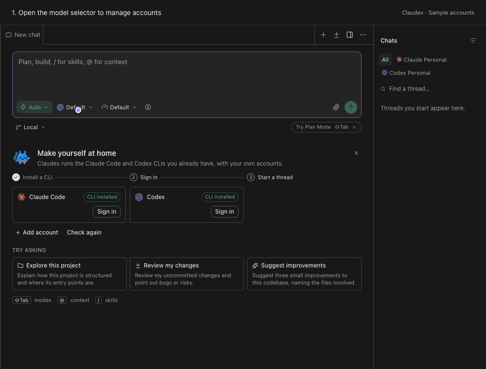
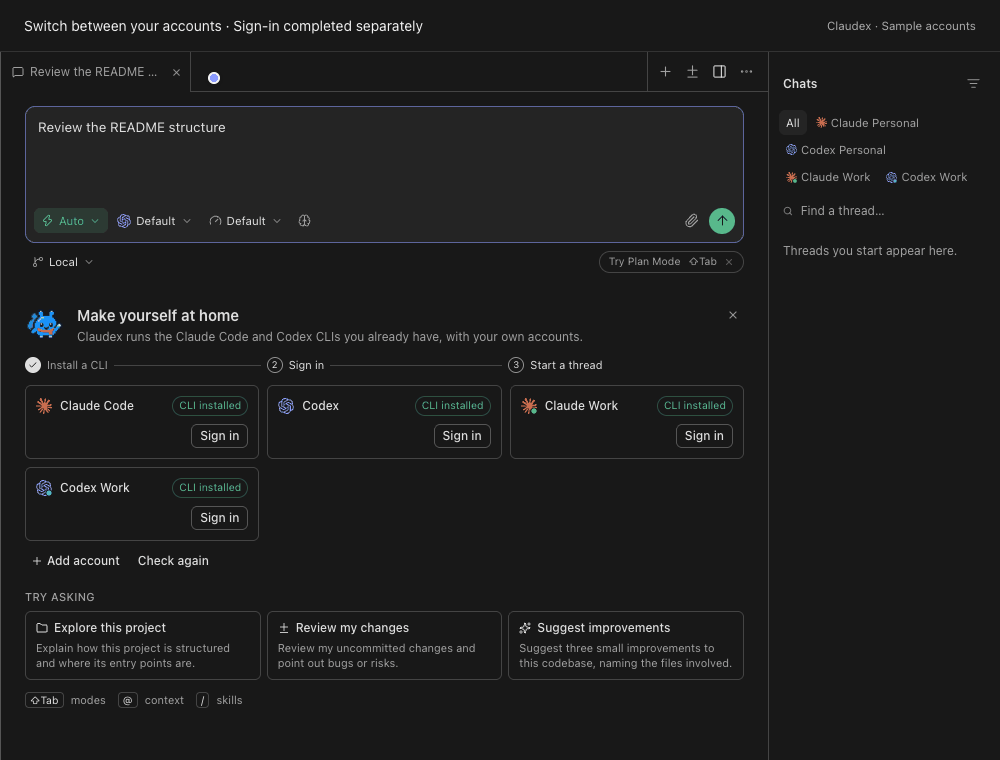

# Claudex user guide

[Back to the overview](../README.md) · [GIF visual guide](visual-guide.md)

## Use

1. Choose **New thread**, type, and press **Enter** (**Shift+Enter** for a new line). Nothing else is asked. The thread takes the name Claude or Codex gives it, falling back to your first line; click the name to rename it.
2. Pick the model and reasoning effort from the model menu: agents on the left, that agent's models on the right. Use ← → to change agent, and type to search all of them. **Default** leaves your CLI's own configuration in place. Models come from your installed CLIs, with older versions under **More models**. The location control sits under the message box.
3. Choose a mode next to it, or cycle with ⇧Tab. **Ask** answers without changing anything, **Plan** researches and writes a plan, and **Auto** works while the CLI's own reviewer handles approval requests, asking you when it can't decide. New chats start in Auto. It reduces prompts but doesn't guarantee safety, and Claude's Auto can push to your default branch unless you state otherwise. If Auto can't apply, the chip says what's really running, such as **Manual** for an unsupported Claude model or **Your Codex settings** when the approval policy isn't `on-request`, and the thread says why. Threads saved in the old Agent mode reopen as **Default**. Your last choice is remembered per agent for new threads. Bypass and full access are never offered.
   - **Plans:** while drafting you see a quiet **Planning…** row. When it's ready, the plan appears inline with **Open plan** and **Edit plan** actions, plus an **Implement in Auto** button (⌘⏎). The plan is saved as Markdown in the extension's own folder rather than your repo. Edit it with **Edit plan**: implementing reads the file when you click, so your edits count. The card also offers Auto or a linked agent. To change the plan, just type in the message box.
   - **Built plans:** once you build a plan, its card folds to one line after the message it followed and stays there, so later turns read without it. The **Plan** chip in the top bar opens the thread's plan from anywhere, and **Docs → Thread plans** lists every thread's saved plan, newest first.
   - **Guided planning:** Plan mode asks for clear, evidence-based plans using the 7 Cs of communication, useful Mermaid diagrams, and acceptance tests. Expand **Planning guide** under your message to inspect the instructions. Disable **Claudex: Guided Planning** to use only the provider's native planning guidance. Turn it on or off from the toggle beside the composer controls in Plan mode.
   - **Implement plan:** the plan card's button switches the thread to Auto and builds. A Plan reply with no plan card shows **Implement** above the composer. If a build can't start, the plan and mode go back as they were, and the notice says why.
   - **Visual explanations:** in Ask mode, agents can add a sandboxed visual (a `visual` code fence holding HTML or SVG) when a picture explains something better. Scripts, network requests, and remote images are blocked. Turn it on or off from the toggle in Ask mode, or with `agentWorkspace.richExplanations`.
   - **Tabs:** open threads appear as tabs, and every click of **+** opens a new chat, so several agents can work at once. What you've typed stays in its tab whether you've sent it or not. Closing a tab only closes the view: the agent keeps going and the thread stays in Chats. A dot marks what needs attention: amber when it needs your review, red when it failed, blue when it finished since you last looked. A spinner means it's running.
   - **Threads:** finished subagents collapse into an **N earlier** row under their parent. **Running only** in the Chats header narrows the list to threads with work going on. Failed and interrupted threads stay visible, and search looks through everything. **Needs you** and **Running** sit at the top of Chats, above the threads sorted by time.
   - **Thinking:** choose Default, On, or Off beside the model picker. Off appears only when disabling thinking is verified for that model; reasoning effort and expandable summaries are separate controls. Default preserves native thinking configuration.
   - **Skills:** type `/` to search your skills, and pick one to add a removable chip. A chip means you asked for it. Only a real tool call from the CLI reads "Used skill". While you type a search, the menu also lists matching skills from your **other accounts**, Claude and Codex alike. Picking one adds a "name · from account" chip: that skill's `SKILL.md` goes with your message as context, read and followed by the agent. It is not invoked as a native skill, its embedded shell commands and argument substitutions don't run, and it is checked against the lending account's files when sent. Choose **Manage skills…** or **… → Skills** to open the Skills page as a tab. It has a search box, a chip for each account (or **All accounts**) and skills grouped by source; expand a row for its file and evidence. **Rescan** refreshes disk findings without starting an agent. **… → Verify with the agent…** asks before native startup, which can run hooks or connect servers. Disk findings have unknown availability; Codex toggles appear after native verification. Selected skills are checked again when sent. In **Configuration**, inspect source files, local precedence estimates, managed declarations, credential references and any selected-session observations. This view is read-only; unresolved policy and unsupported syntax remain visible.
   - **Message actions:** hover a message for its actions. **Quote** puts it (or the text you selected in it) in the message box. On a reply, **Fork** opens a new thread with the same agent that keeps the conversation through that turn: the CLI branches its own session when you send, and the original thread is unchanged. **New chat with context** starts a chat with any agent, with a reviewable record of the thread up to that reply. On your own message, **Edit** puts it back in the box; sending replaces it and every turn after it, and the agent continues from the turn before. Files the agent changed are not reverted, and the CLI keeps its earlier session. Fork and Edit wait until the thread is idle.
   - **Side questions:** type `/btw your question` (or press ⌘; / Ctrl+;) to ask about the conversation without interrupting it, even while a turn runs. The answer appears above the message box. It changes nothing and is saved nowhere: Claude answers from a throwaway branch with no tools that is never written to disk, and Codex from an ephemeral in-memory branch in a read-only sandbox, where it may read files or run read-only commands to answer (shown as a faint line such as *Read 2 files*). The header says which applies. The newest answer stays open and earlier ones fold to a line; a failed or stopped one has **Retry**. Side questions aren't added to the thread, and are forgotten when the window reloads. **Ask in thread** puts the question in the message box to ask it properly.
4. Type `@` to attach context: recent and searched files, folders, past threads, a terminal's last command (where shell integration is on), the branch diff with main, or images. `#` goes straight to files. An `@codex`, `@claude`, or any profile's handle (such as `@claude-work`) at the very start of a message still runs that agent as a child thread.
5. Paste images, attach them with the paperclip, or pick them from `@`. Images Codex generates appear in the thread, and open full size on click.
6. When an agent asks you something, the questions dock on the message box, one at a time. Press a letter to pick, Enter to continue, and Esc to skip; skipping tells the agent you declined.
7. The compact labels and ring beside the paperclip show reported context, 5-hour, and weekly usage when available. Hover for reset times, your plan's limits, the thread's real mode, the skills you asked for, its MCP servers, and its instruction files. A failed MCP server adds an amber dot. It stays hidden until a CLI reports numbers, and offers a handoff when a thread or limit is nearly full. Changes apply from the next turn. Picking a different agent on a started thread continues it there (below).
3. New threads work in your open folder. Choose **New worktree** in the location menu for one thread, or **Continue in a new worktree** later. Worktrees start from committed HEAD and do not copy uncommitted files. The extension never cleans up or merges worktrees.
4. Follow the work in the thread: thinking, commands, and reads collapse into a summary when a turn ends, and diffs stay visible. In Git checkouts, shell edits also appear as **Observed file changes**, compared against the files as they were before the turn and after each command. Existing uncommitted edits are excluded; concurrent edits can be included, so these observations do not establish authorship. Capture excludes ignored files and symlinks and is bounded to 10,000 files, 256 KiB per file, and 32 MiB total; binary, skipped, or unavailable content is identified. Shell renames appear as a deletion and an addition. Historical command diffs are not reconstructed. Approval cards offer **Allow once**, **Decline**, and answers to supported agent questions. Eligible native tool requests also offer **Allow in Auto**: this allows that one request, then continues in the provider's Auto mode. Claude Code switches straight away; Codex applies it from its next turn and requires an on-request approval policy. Provider restrictions still apply.
5. **Run another agent** either way:
   - Start a message with `@codex`, `@claude`, or a profile's handle, or pick one from the `@` menu anywhere in a message, which moves it to the front and keeps your words. A name you type mid-sentence and don't pick stays plain text. It runs straight away in a card, under the agent you had selected, which isn't sent the message. Each card shows who asked and in what words. Its result is added to your next message only if you choose **Add this result**.
   - Ask in plain words: "run a Codex agent and tell it to review this." The agent calls its `run_agent` tool, you approve the prompt, the other agent runs as a child thread, and its final message goes back to the agent that asked.

   Child threads appear on an inline card and nested in the sidebar. Their approvals appear on the card too. Each one is a normal session you can open and message. Both agents share the folder unless you started in a worktree, so avoid overlapping edits.
6. Open **Changes** in the header to see every uncommitted change in the thread's checkout, read from Git. Each file opens in VS Code's diff editor.
   - **Continue in another agent:** pick another agent in the model menu, or use **… → Continue in** another agent or profile. Your draft moves with a **Context from …** chip; click it to see exactly what will be sent, or remove it. Nothing goes until you press Enter. The other agent receives your messages, its replies, commands with their reported status and exit codes, files changed, and the plan, kept by this extension and built with no extra model call. Going back to an agent that already has a linked thread resumes that same native session and sends only what happened since. Hidden reasoning, provider-side context, and approvals never transfer, and a thread still working in the same checkout must finish or be stopped first. `agentWorkspace.crossAgentContext` chooses `recent` (about 10k tokens, the default), `full` (about 75k), or `off`, which moves only your draft as before. The history goes to the other provider, so mind what your project allows.
7. Use **Docs** for plans, task briefs, reviews, and handoffs in `docs/agent-work/`. Agents can write there too, and the list updates itself. A handoff opens the other provider with an editable draft that is never sent automatically.
8. Use the terminal button in the top bar to continue a thread in the native CLI, in the same mode and on the same model where the CLI has a flag for it (Codex has none for Plan, and the thread says so). A running turn is stopped first, after asking. Send at least one message first so a provider session ID exists. While it's open, the composer offers **Show terminal** and **Back to chat**. When it closes, what happened there is added to the chat under a "From terminal" notice.

## Multiple accounts

Use separate profiles for personal and work Claude Code or Codex accounts:

1. Open the model selector below the composer and choose **Manage account**.
2. Choose **Add account**, select **Claude Code** or **Codex**, and enter an account name.
3. Leave **Account folder** set to **Create a separate account**, or choose **Use an existing folder…** to reuse an existing CLI setup.
4. Choose **Add account**, then **Open sign-in terminal**. Complete authentication in the installed CLI’s terminal.
5. Return to chat, open the model selector, choose the account, and select a model. Selecting it does not send your draft.

Adding a profile does not complete sign-in. **CLI installed** reports executable availability, not authentication status. Each separate account folder has its own sign-in and settings. Some skill roots, including Codex’s `~/.agents/skills`, can be shared across profiles.



[Still image: added accounts and sign-in action](../media/guide/accounts-add.png)



[Still image: selected account with an unsent draft](../media/guide/accounts-switch.png)

Choose an account in **Accounts** to rename it or inspect its folder. Removing a custom profile keeps its account files and chat history on this machine; chats using that profile need it restored to continue.

## Local boundaries

There is no application backend, model API integration, extension telemetry, or credential store. The extension launches your unmodified CLIs; those tools retain their normal provider connections, settings, authentication, and usage limits. No agent configs or harness code are patched. The Claude SDK is used only to bridge your installed Claude Code executable and its permission callbacks.

Transcript projections and session references are stored as a versioned JSON file under VS Code’s workspace-specific extension storage. Drafts and scroll positions use local webview state. These records may include prompts and tool output; treat them like local CLI history. Unfinished sessions restore as interrupted and are not automatically restarted.

By default, dark themes use Cursor's dark colors. Choose **Use editor theme colors** from the `...` menu, or set `agentWorkspace.appearance` to `editor`, to follow VS Code's theme everywhere. Light and high-contrast themes always follow VS Code, and fonts, syntax colors, and diff colors follow it in every mode. Ask, Plan, Agent, and Auto each have their own color on the mode chip and send button.

## Upgrading from Agent Workspace

Claudex uses the extension ID `nerdyabhi.claudex`. The earlier local build used `local-workspace.agent-workspace`, so VS Code treats these as separate extensions with separate storage. Existing history is not automatically migrated; keep the old installation and its data if you need those threads. Disable the old extension before using Claudex to avoid duplicate commands and views. Settings retain their `agentWorkspace.*` keys.

## Development

Node 24 and pnpm 10.33.2 were used. From this independent project folder:

```sh
pnpm install --frozen-lockfile
pnpm check
pnpm test:ui
pnpm package
```

`pnpm package` writes `releases/claudex-<version>.vsix` using the version in `package.json`. `pnpm test:ui` saves all captures, including failure screenshots, to `test-results/screenshots/`. Both output folders are ignored by Git and excluded from the VSIX.

Press **F5** in VS Code to launch an Extension Development Host. `pnpm preview` serves a design-only preview at `http://127.0.0.1:4173`. It cannot run agents. `pnpm smoke` sends tiny test prompts through both signed-in CLIs and verifies conversation resume. `pnpm smoke:delegate` has each agent run the other through `run_agent` and checks the answer comes back. Both use normal provider quota.

See `docs/integration.md` and `docs/verification.md` in the local project for integration notes and verification evidence.

## Current limits

- **Ask on Claude:** edit tools are off and anything not already allowed is denied, but a Bash command your Claude settings allow can still run. Codex's Ask is a read-only sandbox with no network.
- **Fork and Edit** branch at whole turns, because that's where each CLI can resume. A thread read back from Codex's history before this version has no turn positions, so it offers **New chat with context** instead. A fork made from Codex doesn't carry the `run_agent` tool.
- **Side questions** on Codex are read-only rather than tool-free: every approval is declined and nothing can be written, but Codex may read files to answer.
- **Fork and Edit after continuing with another agent** work only on turns since the switch; earlier turns belong to the previous agent's CLI, so use **New chat with context** for those.
- **Claude disk findings** show their inspected file and source. Native command verification reports no source/path; those details stay unknown. Claude standalone skills have no general native on/off toggle here.
- There's no marketplace or installer here. The only skill change Claudex makes is **Make global**, after you confirm it (below).
- Only sessions created by this extension are indexed. Existing CLI history and already-running terminal sessions are not imported.
- A delegated agent cannot see the conversation that started it; it receives only its prompt. A delegated agent cannot start another.
- Codex and Claude both expose only part of their thinking: summaries, when the model produces them. Some turns show none.
- Most Codex threads keep their first-prompt title, because Codex usually leaves its thread name unset.
- Internal worker visibility depends on provider events. Full child transcripts are not guaranteed; Claude task IDs are not resumable conversation IDs.
- Terminal activity appears in the chat when the terminal closes, as text with a count of tool calls, not live. After a window reload a terminal that's still open isn't tracked, so avoid sending from both.
- Complex unsupported Codex requests are rejected rather than implicitly approved. Native CLI access remains available. CLI/SDK upgrades need compatibility testing.
- Closing or reloading the extension interrupts rich-chat work. Native terminals remain managed by VS Code. Native live workers, interactive pickers, every permission type, and prolonged workloads still need manual end-to-end acceptance.

Claudex is developed and tested on macOS. Windows, Linux, remote workspaces, and prolonged workloads have not yet been validated.

## License

The source code is MIT licensed; see [LICENSE](../LICENSE). A built VSIX also bundles the Claude Agent SDK, which is under Anthropic's own terms, not MIT; see [THIRD_PARTY_NOTICES.md](../THIRD_PARTY_NOTICES.md).

## Agents and profiles

Claudex finds `claude` and `codex` on your PATH (and in `~/.local/bin`, `/opt/homebrew/bin`, `/usr/local/bin`) and runs `--version` on each. Both always appear in the agent menu. One that isn't installed is dimmed, says why, and can't be started or mentioned. `agentWorkspace.claudePath` and `agentWorkspace.codexPath` point at another binary.

A **profile** is another account for one of those CLIs: the same binary run with its own home folder. That folder is `CLAUDE_CONFIG_DIR` for Claude Code and `CODEX_HOME` for Codex. Add as many as you like:

- **Agent menu → Add profile.** Folders that already look like an account (`~/.claude-*` or `~/.codex-*` with settings, sign-in or history in them) are offered first. Otherwise you get a new empty folder or pick one.
- Name it anything and **Rename** it later. Its handle (`@claude-work`) is fixed, because threads remember it.
- **Sign in** opens the CLI in a terminal with that profile's folder, so you sign in with the CLI's own flow. Claudex never sees the credentials.
- **Remove** deletes only the profile entry. The folder stays, and so do its threads, which say they can't continue until you add the handle again.

Everything is stored in `agentWorkspace.profiles`, which you can also edit by hand:

```json
"agentWorkspace.profiles": [
  { "id": "claude-work", "name": "Work", "provider": "claude", "configDir": "~/.claude-work" },
  { "id": "codex-client", "name": "Client", "provider": "codex", "configDir": "~/.codex-client" }
]
```

**What each profile keeps to itself** is everything in its home folder:
- sign-in
- `settings.json` and permission rules
- personal skills, plugins and MCP servers
- `.claude.json` (for Claude)
- session history

Project files are shared on disk, including `CLAUDE.md`, `AGENTS.md`, `.claude/`, and `.agents/skills`. Each provider decides which it loads. Codex can also share user skills in `~/.agents/skills` across account homes.

A new profile may still see skills from shared native roots. On the Skills page, **Missing here** lists skills other accounts have that the chosen one doesn't, compared by name. **Make global** on a personal folder skill (`<name>/SKILL.md`) keeps one shared copy in `~/.agents/skills`, the Agent Skills user folder that every Codex account already reads, and links it into each Claude account's `<config dir>/skills`, since Claude Code reads only that folder but follows linked skill folders. After that, editing the skill once changes it everywhere, and the page marks it **Global**. To do several at once, tick the skills (or **Select all** for what's listed) and choose **Make N global**; one confirmation covers them all, and a skill that can't be made global is listed without stopping the rest. A confirmation lists exactly what changes first. An account's identical copy is moved to the Trash and replaced by a link; a different version, or a link to somewhere else, is left alone; a different skill with the same name already in `~/.agents/skills` stops the change. Scripts in the skill are not run. Project skills stay with their repository. Afterwards the skill shows as found on disk; each agent confirms it on the next send or **Verify**, and a running conversation may need a new session to see it.

A thread runs on the profile it started with, including when resumed in the native terminal, since its history is in that profile's folder. A profile whose folder has gone stops with an error rather than running on your default account.

**Shell aliases** such as `claude2='CLAUDE_CONFIG_DIR=~/.claude-account2 claude'` are invisible to VS Code, so add that folder as a profile. Threads from before profiles still run as **Claude 2** (`@claude2`). That profile is listed when old threads use it, when a `claud2`/`claude2` executable exists, or when `agentWorkspace.claud2Path`/`claud2ConfigDir` is set. **Save** in its menu turns it into a normal profile you can rename.
